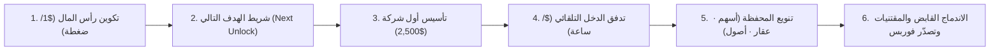

# دستور استوديو تطوير اللعبة وإعادة هندسة التجربة (AAA Game Design & Experience Bible)
## مشروع: Empire Tycoon — من واجهات إدارية إلى عالم إمبراطورية مالية حي

> **إعداد:** استوديو الإنتاج المتكامل (Creative Director · AAA Art Director · Senior Game UI/UX · Economy & Systems · Mobile RTL Engineering · QA)  
> **المرجع التشخيصي:** لقطات الهاتف الفعلية (`133143`, `133147`, `133152`, `133157`, `131529`, `131548`) والشيفرة المصدرية الحالية (`9e39858`).

---

## 1. الفحص النقدي للواجهات الحالية (Game Experience Audit — التشخيص الصريح)

فحصنا اللقطات الست الملتقطة من جهاز أندرويد الفعلي (`com.empiretycoon.game.MainActivity`) بعين لجنة اعتماد جودة داخل استوديو ألعاب تجاري، وفيما يلي التشخيص الصريح دون مجاملة:

### أ. تشخيص لقطة `133143` — شاشة «سوق الاستثمار / الأسهم»
* **العناصر الناجحة:** وضوح شريط التبويبات الفرعي (`الأسهم | العقار | الأصول الرقمية`)، ثبات الرصيد `$ 35.00` في الرأس، وبروز زر `($) الأرباح` في منتصف الشريط السفلي.
* **العيوب البصرية والوظيفية القاتلة:**
  1. **انعدام هوية العالم (Spreadsheet Syndrome):** بطاقة `خطوط شحن المرسى (HRBR) — $ 120.64 — شراء 1` تبدو كسطر في جدول بنكي جامد. لا يوجد منحنى حركة سعرية (Sparkline Chart)، ولا درجة مخاطرة، ولا قصة قصيرة تربط الشركة بميناء وادي المرسى.
  2. **غياب معاينة أثر القرار (Missing Decision Consequence):** العائد مكتوب كنسبة مئوية مجردة (`توزيع/ساعة 0.22%`)، ما يجبر اللاعب على إجراء قسمة ذهنية ليعرف كم دولارًا سيكسب في الساعة! كما أن الأزرار المعطّلة (`شراء 1`) لا تخبره كم دولارًا ينقصه للشراء.
  3. **ضعف دافع الاستحواذ:** العداد `تملك: 0/500` نص صامت بلا شريط استحواذ بصري (Buyout Progress Bar) يشعل رغبة السيطرة على الشركة.

### ب. تشخيص لقطة `133147` — شاشة «إمبراطورية الأعمال» (حالة `0/10` شركات)
* **العيوب البصرية والوظيفية القاتلة:**
  1. **فراغ ميت في نصف الشاشة السفلي:** وجود مربع أبيض صغير `لا تمتلك أي شركة بعد` تحته مساحة فارغة شاسعة يقتل الحماس في الدقائق الأولى.
  2. **انقطاع حلقة التقدم (Broken Core Loop Bridge):** اللاعب يملك `$ 35.00` في رصيده، لكن الشاشة لا تعرض له **هدف التأسيس الأول** (*«أقرب شركة للتأسيس: سنابل الوادي لتوزيع الأغذية — جمعت `$ 35.00` من `$ 2,500.00` — العائد الفوري: `+$ 1,800.00 / ساعة`»*) مع شريط تقدم ومشهد بصري يحفّزه للعودة لشاشة النقر وإكمال المبلغ.

### ج. تشخيص لقطة `133152` — شاشة «معرض المقتنيات والفخامة»
* **العيوب البصرية والوظيفية القاتلة:**
  1. **كسر طباعي في شارة الإكمال:** الرقم `0 / 11` انكسر داخل الشارة إلى سطرين مشوهين (`/ 0` فوق `11`).
  2. **غياب تام لشعور الفخامة والندرة:** «هايبركار المرسى النادرة» بسعر `$ 1.40M` معروضة داخل بطاقة بيضاء مسطحة وبجانبها **نفس أيقونة شاحنة التوصيل الصغيرة**!
  3. **غياب المكانة والندرة (No Prestige or Rarity Tiers):** لا توجد رسوم مخصصة لكل مقتنى (سيارة سباق، طائرة نفاثة، يخت ملكي، لوحة فنية، جزيرة خاصة)، ولا تصنيف ندرة (`نادر`, `ملكي`, `أسطوري`)، ولا نقاط هيبة (`+Prestige`) تفسر لماذا يقتني الإمبراطور هذه الأصول.

### د. تشخيص لقطة `133157` — شاشة «ملف المستثمر»
* **العيوب البصرية والوظيفية القاتلة:**
  1. **غياب هوية ومرتبة اللاعب (No Player Status / Wealth Tier):** لا توجد بطاقة مكانة تعكس تطور اللاعب من `مستثمر ناشئ` إلى `مؤسس أعمال` ثم `قطب الميناء` ثم `إمبراطور السيادة`.
  2. **شعور «تبخّر المال» بعد ترقية النقر:** في اللقطة، جمع اللاعب `$ 535.00` من النقر وأنفق `$ 500.00` لترقية مستوى الضغطة، فظهرت ثروته `$ 35.00` فقط! عدم إظهار **«مستوى قوة النقر والمهارة المكتسبة»** في بطاقة الهوية يجعل اللاعب يشعر وكأنه خسر `$500` بدل أن يشعر بأنه استثمرها في مضاعفة قوته.
  3. **غياب أوسمة الإنجاز ومعالم الطريق (Missing Achievements & Next Rival):** بطاقة فوربس تعرض `#8` فقط دون إظهار المنافس الذي يسبقك مباشرة (`#7 كريم المنصور — $ 15,000`) وكم يفصلك عن انتزاع مركزه.

### هـ. تشخيص لقطتي `131529` و`131548` — شاشة «قرار ما بعد الإقفال والتشخيص» (اليوم ٣١)
* **العيوب البصرية والوظيفية:**
  1. رغم أن القرار أصبح فوق الطيّة، فإن البطاقات ما زالت تبدو كـ «نموذج محاسبي» أكثر منها **غرفة قرارات مجلس إدارة (Executive Boardroom Deck)**، وتحتاج إلى شريط مقارنة بصري للسيولة المتبقية مقابل الإيجار المستحق مع توحيد العملة بالدولار (`$`).

---

## 2. الرؤية الإبداعية (Creative Vision — "Sovereign Harbor & Capital Noir")

> **الهوية الإبداعية الأصيلة للعبة:**  
> **"وادي المرسى: من رصيف الشحن إلى قمة السيادة المالية"** — عالم اقتصادي متوسطي دافئ يمزج بين **هيبة المصارف الخاصة الداكنة (Emerald & Obsidian Vaults)** و**حرارة الموانئ والمصانع الذهبية (Golden-Hour Industrial Dioramas)**.

* **القاعدة الذهبية:** كل شاشة يجب أن تمنح اللاعب:
  1. **مشهدًا أو تمثيلًا بصريًا حيًا** (منحنى سوق SVG، لوحة مقتنى مرسومة، شريط استحواذ، أو مشهد قطاع).
  2. **وزنًا واضحًا لكل دولار (`$`)**: كل سعر يقابله أثر فوري بالدولار في الساعة (`+$ X.XX / ساعة`) وفترة استرداد رأس المال.
  3. **تطورًا في المكانة (Status Evolution):** كلما نمت ثروتك، ارتقت رتبتك الاقتصادية وتبدّلت أوسمتك وشاراتك في الرأس العلوي وملف المستثمر.

---

## 3. دليل التوجيه الفني (Art Direction Bible)

| المحور الفني | القرار المعتمد | السبب الهندسي والفني |
|---|---|---|
| **المزاج العام (Mood)** | فخامة تنفيذية دافئة (Sovereign Emerald, Warm Limestone, Burnished Amber) | يتجنب برود تطبيقات البنوك الزرقاء التقليدية، ويمنح اللعبة بصمة بصرية خاصة بها. |
| **الخامات والطبقات (Materials)** | أسطح متعددة الطبقات: بطاقات سيادية داكنة (`#0f2820` → `#183f33`) للمحفظة والمقتنيات النادرة، وبطاقات عاجية مصقولة (`#fffdf8`) بحواف دقيقة وظلال دافئة للعمليات اليومية. | يخلق تباينًا بصريًا فوريًا بين «الخزنة والهيبة» وبين «أوراق العمل والأسواق». |
| **الإضاءة والعمق (Lighting)** | إضاءة حواف علوية دافئة (`inset 0 1px 0 rgba(255,244,214,0.18)`) مع ظلال سفلية مجسّمة للأزرار التفاعلية. | يمنح الأزرار والبطاقات ملمسًا ماديًا (Tactile Game Feel) عند اللمس على شاشة الهاتف. |
| **الرسوم والأيقونات (Imagery)** | مشاهد فنية أصلية للقطاعات الخمسة + **منحنيات SVG حية للأسهم والأصول الرقمية** + **رسوم SVG مخصصة للسيارات والطائرات واليخوت والتحف والقصور**. | يقضي نهائيًا على البطاقات النصية الجافة وأيقونات الشاحنة المكررة. |

---

## 4. النظام البصري الشامل (Game Design System)

### أ. لوحة الألوان ودرجات الثروة والندرة (Color & Tier Tokens)
* **الألوان الأساسية:**
  * `--forest-obsidian: #0c211b` (خزنة البنك وقاعة الفخامة)
  * `--sovereign-emerald: #145b4a` (الإجراء الأساسي والنمو الإيجابي)
  * `--limestone-canvas: #eef1e8` (خلفية العالم)
  * `--ivory-deck: #fffdf8` (بطاقات الأسواق والعمليات)
  * `--burnished-gold: #e5b869` (علامات السيادة، النجوم، وتفاصيل الخزنة)
* **درجات المخاطرة وحركة السوق:**
  * `--risk-low: #176b4d` (`مخاطرة منخفضة`)
  * `--risk-med: #9c6514` (`مخاطرة متوسطة`)
  * `--risk-high: #a63228` (`مخاطرة عالية`)
* **درجات ندرة المقتنيات (Rarity Tiers):**
  * `نادر (Rare)`: إطار زمردي `#2b7a62` + خلفية `#122e25`
  * `ملكي (Sovereign)`: إطار ذهبي `#d4a149` + خلفية `#1c2638`
  * `أسطوري (Mythic)`: إطار كهرماني متوهج `#e89b3c` + خلفية `#261829`
* **مراتب الثروة (Wealth Tiers):**
  1. **مستثمر ناشئ (`Seed Hustler`)** — `$0` إلى `$2,499`
  2. **مؤسس أعمال (`Venture Founder`)** — `$2,500` إلى `$49,999`
  3. **قطب الميناء (`Harbor Baron`)** — `$50,000` إلى `$999,999`
  4. **رئيس تكتل قابض (`Holding Magnate`)** — `$1M` إلى `$99.9M`
  5. **إمبراطور السيادة (`Sovereign Tycoon`)** — `$100M+`

### ب. نظام الخطوط والأرقام في العربية RTL (Typography & Numerical Rules)
* كل مبلغ بالدولار يُعرض بصيغة قياسية موحّدة `$ 1,250.00` داخل حاوية معزولة الاتجاه (`dir="ltr"` + `white-space: nowrap`) حتى لا تنفصل علامة `$` عن الرقم ولا تنعكس إشارة `+` أو `-`.
* العوائد الساعية تكتب بصيغة واضحة: **`+$ 1,800.00 / ساعة`** بدل النسب المئوية الغامضة.
* شارات العدادات (`0 / 11`, `2 / 10`) تلتزم بـ `white-space: nowrap` لمنع الكسر الطباعي الذي ظهر في اللقطة `133152`.

---

## 5. هندسة التنقل ورحلة اللاعب وحلقة اللعب (Navigation & Core Gameplay Loop)

* **الأسئلة الثمانية في كل شاشة:**
  1. **أين أنا؟** شريط علوي موحّد يعرض اسم القسم + مرتبتك الاقتصادية الحالية + رصيدك الحي + دخلك الساعي.
  2. **ماذا أملك؟** عدادات ملكية وأشرطة استحواذ ملوّنة في كل قسم.
  3. **ما القرار المتاح وما أثره؟** كل بطاقة شراء تعرض: **التكلفة (`$`)** + **العائد المضاف (`+$ / ساعة` أو `+نقاط هيبة`)** + **المتبقي لفتحها إن كان الرصيد أقل**.

---

## 6. خارطة إعادة تصميم الشاشات ومواصفاتها التفصيلية (High-Fidelity Screen Specifications)

### الشاشة 1: «الأرباح» (`Earnings` — خزنة البنك وساحة الصفقات)
* **بطاقة بنك إمباير السيادية:** تعرض في أعلاها **لقب المرتبة الاقتصادية** (`مستثمر ناشئ` ← `إمبراطور السيادة`)، الرصيد الحي بخط كبير، الدخل التلقائي `/ ساعة`، وقيمة الضغطة الحالية.
* **بطاقة «الفرصة القادمة» (Next Empire Target Radar):** شريط ذكي أسفل منطقة النقر يربط النقر بعالم اللعبة فورًا: يعرض أقرب هدف استثماري يمكنك فتحه برصيدك الحالي (مثل: *«أول سهم في أسواق السنبل: `$ 35.00 / $ 48.00`»* أو *«تأسيس شركة سنابل الوادي: `$ 480 / $ 2,500`»*) مع زر انتقال مباشر فور اكتمال المبلغ!
* **ساحة النقر المجسّمة (Tactile Vault Mint Pad):** تصميم خزنة/ختم صفقات دائري بطبقات حلزونية ومؤشر المستوى القادم (`المستوى 1 ← المستوى 2 عند $500.00`).

### الشاشة 2: «إمبراطورية الأعمال» (`Business` — غرفة العمليات التنفيذية)
* **القضاء على الفراغ الميت في حالة `0/10`:** عرض **«بطاقة المشروع الافتتاحي الموصى به» (Flagship Venture Spotlight)** بمشهد مستودع الميناء، شريط التقدم المالي نحو `$ 2,500.00`، العائد الساعي المضمون `+$ 1,800.00 / ساعة`، وخريطة طريق من 3 مراحل.
* **بطاقات الشركات المملوكة والمرشحة:** كل شركة تعرض مشهدها الفني، شريط مستوى التوسعة (`Lv 1..10`)، شارة الاستراتيجية النشطة، العائد الساعي الحالي، وأثر الترقية التالية (`+$ X / ساعة`).

### الشاشة 3: «سوق الاستثمار» (`Investing` — قاعة التداول والعقار)
* **تبويب الأسهم (`Shares`):** إعادة تصميم كاملة لبطاقة السهم لتشمل:
  1. شعار القطاع + رمز التداول (`HRBR`, `SNBL`...) + وصف دور الشركة في اقتصاد المدينة.
  2. **منحنى سعري حي (Live SVG Sparkline Chart)** لآخر 12 نبضة سوق مع تظليل تحته.
  3. **شارة درجة المخاطرة** (`مخاطرة منخفضة / متوسطة / عالية`).
  4. **العائد النقدي المباشر بالدولار** (`توزيع: +$ X.XX / ساعة لكل سهم`) بدل النسبة المئوية فقط.
  5. **شريط الاستحواذ على الشركة (`0 / 500 سهم`)** مع نسبة الملكية المئوية.
  6. أزرار شراء توضح التكلفة الإجمالية أو المبلغ المتبقي لفتح الشراء.
* **تبويب العقار (`Real Estate`):** إضافة **فترة استرداد رأس المال بالساعات (`Payback: Xh`)** بجانب `الإيجار / ساعة` و`العائد الساعي %` ومشهد العقار.
* **تبويب الأصول الرقمية (`Digital Assets`):** منحنى SVG حي + شارة التقلب + قيمة الحيازة والربح/الخسارة الجارية بالدولار.

### الشاشة 4: «معرض المقتنيات والفخامة» (`Items` — قاعة العرض السيادية)
* إصلاح شارة العداد العلوية (`0 / 11`) بـ `white-space: nowrap`.
* تحويل البطاقات إلى **بطاقات قاعة عرض فاخرة (Luxury Showroom Cards)** تتضمن:
  * **رسم SVG فني مخصص لكل مقتنى** (سيارة سباق، ليموزين، طائرة نفاثة، يخت ملكي، عملات/لوحة فنية، فيلا/جزيرة خاصة).
  * **شارة الندرة** (`نادر · Rare`, `ملكي · Sovereign`, `أسطوري · Mythic`).
  * **مكافأة المكانة والهيبة (`+Prestige`)** التي ترفع تصنيف هويتك في ملف المستثمر.

### الشاشة 5: «ملف المستثمر» (`Profile` — السيرة المالية وقاعة فوربس)
* **بطاقة الهوية والسيادة (Sovereign Dossier):** تعرض لقب المرتبة الاقتصادية، نقاط الهيبة (`Prestige`)، مستوى قوة النقر المكتسبة، وإجمالي الثروة (`Fortune`).
* **بطاقة المنافس التالي في فوربس (Next Forbes Target):** تعرض مباشرة الشخص الذي يسبقك في الترتيب العالمي وشريط تقدم ثروتك نحو تجاوزه.
* **شبكة أوسمة الإمبراطورية (Empire Achievements Grid):** 6 أوسمة بصرية تفاعلية توضح ما أنجزته وما ينتظرك.

---

## 7. خطة التنفيذ التقني ومعايير القبول (Implementation & AAA Quality Gate)

1. **وحدة الرسوم والمخططات المدمجة (`apps/game/src/empire/visuals.ts`):**
   * مولّد منحنيات الأسعار الحية (`buildSparklineSvg`) بدون مكتبات خارجية وبأداء 60fps.
   * رسوم SVG مخصصة لفئات المقتنيات الفاخرة (`buildLuxuryArtworkSvg`).
   * نظام حساب المرتبة الاقتصادية ونقاط الهيبة والأوسمة (`computePlayerStatus`).
2. **تحديث شاشات الصدفة الخمس (`earnings-view.ts`, `business-view.ts`, `investing-view.ts`, `items-view.ts`, `profile-view.ts`) وأنماطها (`views.css`, `shell.css`)** مع الحفاظ على كل ملف ≤ 350 سطرًا.
3. **معايير القبول غير القابلة للتفاوض:**
   * صفر بطاقات نصية جافة في الأسهم أو الأعمال أو المقتنيات.
   * صفر كسر طباعي في الشارات أو أسعار الدولار (`$`) في RTL وLTR وحتى تكبير 200%.
   * نجاح جميع اختبارات `check:file-size` و`typecheck` و`vitest` و`playwright + axe-core WCAG 2.2 AA`.
